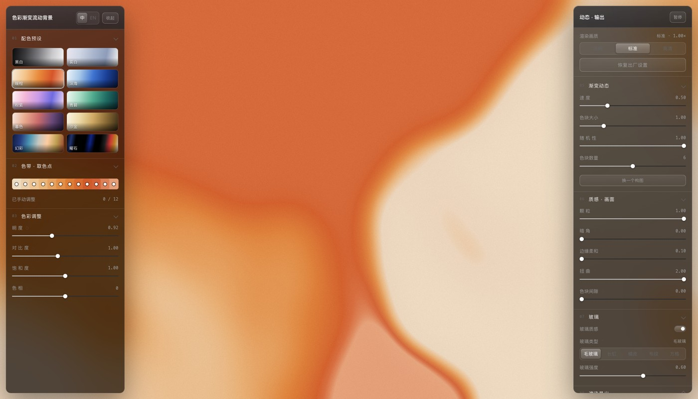

[中文](README.md) | **English**

# Gradient Flow — a slowly drifting colour-gradient background

> **A note from the author**: I don't know how to program. Every line of code, every feature — and this document — was written by AI. Please forgive any amateurish mistakes.



A browser tool that renders a **slowly flowing colour-gradient background** in real time with plain WebGL.
No dependencies, works offline, nothing to install.

Colours come from 10 presets plus 12 editable swatch points on a colour band. You can adjust glass texture,
grain and warp, export stills or image sequences, or export a ready-to-embed background for your own page.

## Three ways to open it

| Way | How | Good for |
|---|---|---|
| **Single file** | Download [`gradient-flow.html`](gradient-flow.html) and double-click it | Sharing / offline use — the whole tool is one ~180 KB file |
| **Online** | Open <https://afeiisfine.github.io/gradient-flow-background/> | No download, just see it |
| **Source** | Keep `index.html`, `app.js`, `styles.css` in one folder and open `index.html` | Modifying the code |

The single-file build is generated from the same sources by `tools/build-standalone.py`,
which inlines the CSS and JS. Re-run it after editing the sources so the two never drift apart.

## Features

**Colour**

- 10 presets: Mono, Mist, Amber, Ocean, Bloom, Jade, Dusk, Sand, Prism, Obsidian
- 12 swatch points on the colour band, each with an inline picker (HSV / HEX)
- Global brightness, contrast, saturation and hue

**Motion**

- 2–10 colour blobs, each drifting along its own noise path
- Adjustable speed, blob size and randomness; "New composition" reseeds
- Domain warp turns round blobs into flowing, finger-like edges

**Texture**

- Grain, vignette, edge softness, warp strength, gap between blobs
- Glass: frosted / reeded / orange-peel / woven / grid, with a master switch
- The last four skip blur and instead displace the sampling coordinates with the gradient of a
  procedural height field — real refraction, not a texture overlaid on top

**Output**

- Single-frame PNG
- PNG sequence: 1–30 s, 24 / 30 / 60 fps, 720p / 1080p / 1440p / portrait, zipped
- Embeddable background: a self-contained HTML file (WebGL plus a pure-CSS fallback) with the
  current parameters frozen into it

**Other**

- Chinese / English UI
- Three render-quality levels (0.6× / 1.0× / 1.5×)
- Parameters persist in localStorage; "Restore defaults" resets everything

### Keyboard shortcuts

| Key | Action |
|---|---|
| `Space` | Play / pause |
| `Tab` or `H` | Hide / show both panels |
| `R` | New composition |
| `P` | Export the current still |
| `G` | Grain on / off |
| `←` `→` | Speed −/+ 0.05 |
| `↑` `↓` | Blob size ±0.05 |

## How it renders (three passes)

The "colour fog" look is really a few large, soft blobs drifting slowly and bleeding into each other:

```
1. Field pass: every blob takes a colour-band coordinate u_i; weights use an exponential
   kernel relative to the nearest blob, and blending happens in band-coordinate space
   (not RGB). Written to an RGBA16F offscreen texture.
2. Blur pass: separable Gaussian, horizontal then vertical (skipped when glass is off).
3. Composite pass: procedural glass height field -> gradient -> displaced sampling
   coordinates (refraction) -> vignette / specular -> sRGB -> two TPDF dither layers.
```

**Why field and composite are separate passes**: frosted glass needs a real low-pass filter.
A single fragment pass can only sample neighbouring *screen pixels*, not neighbouring
*field coordinates*, so the field must be written to an offscreen texture before blurring.

## Files

```
index.html                  page structure (source version entry)
app.js                      all logic plus shaders (~2,700 lines)
styles.css                  UI styles
gradient-flow.html          single-file build (generated, ready to share)
tools/build-standalone.py   builds the single-file version
assets/                     README images
```

## Building the single-file version

```bash
python3 tools/build-standalone.py
```

It inlines `styles.css` and `app.js` into `index.html` and writes `gradient-flow.html`,
verifying that no external references remain in the output.

## Requirements

**WebGL2** (Chrome, Edge, Firefox, Safari 15+).
If the GPU lacks `EXT_color_buffer_float`, the tool falls back to a sharp path that skips the
blur pass; the image still renders.

## License

MIT — see [LICENSE](LICENSE). Credit the author and you may use, modify and redistribute it.
